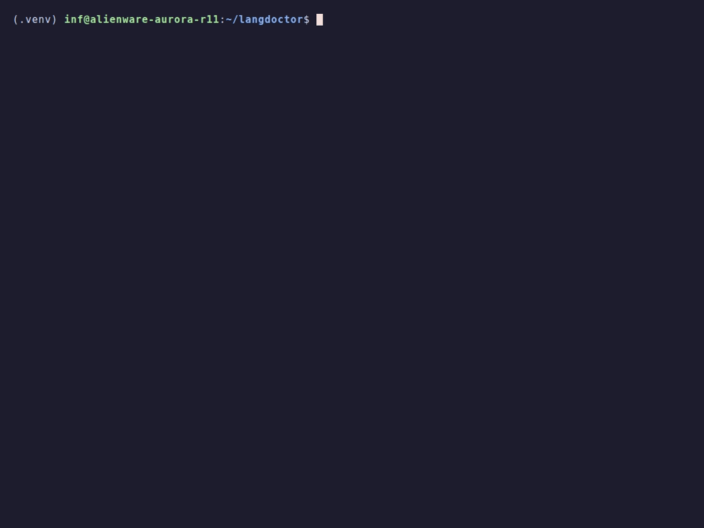

# langdoctor 🩺

> **Scan your LangGraph/LangChain project for known CVEs, insecure configs, and production footguns — in seconds, offline, no API key.**
>
> _brew doctor for your agent stack._

[](https://pypi.org/project/langdoctor/)
[](https://pypi.org/project/langdoctor/)
[](https://github.com/elaz48/langdoctor/actions/workflows/ci.yml)
[](LICENSE)



## Quickstart

```bash
pipx run langdoctor        # or: uvx langdoctor
```

Run it in your project directory. langdoctor reads your dependency files and
source, reports issues grouped by severity, and exits non-zero when it finds
something at or above your threshold.

```bash
langdoctor                 # scan the current directory
langdoctor path/to/project # scan a specific directory
langdoctor list-checks     # every check, with IDs and severities
langdoctor --version       # tool version + advisory DB date
```

## Why

2026 has been a rough year for the agent stack:

- **Langflow is under active attack.** `CVE-2025-3248` (unauthenticated RCE) was
  added to the [CISA KEV catalog](https://www.cisa.gov/known-exploited-vulnerabilities-catalog)
  and [exploited to deploy the Flodrix botnet](https://www.trendmicro.com/en_us/research/25/f/langflow-vulnerability-flodric-botnet.html);
  `CVE-2026-5027` (path-traversal → RCE) is [being exploited across ~7,000 exposed instances](https://www.bleepingcomputer.com/news/security/path-traversal-flaw-in-ai-dev-platform-langflow-exploited-in-attacks/).
- **LangGraph checkpointer CVEs** — SQL injection and unsafe deserialization in
  the SQLite/base checkpointers can chain to RCE via forged checkpoint rows.
- **Supply-chain attacks** on the CI actions and packages the ecosystem depends
  on (the tj-actions and LiteLLM incidents) mean a pinned-to-a-tag action or an
  unpinned dependency is a real risk surface.

These are exactly the things a framework-specific linter can catch before you
ship. langdoctor ships the CVE data with the package and runs fully offline.

## What it checks

<!-- BEGIN check-table (generated from `langdoctor list-checks`) -->
| ID | Category | Severity | What it catches |
| --- | --- | --- | --- |
| `LD101` | Known CVEs | high | SQL injection via metadata filter key in SQLite checkpointer |
| `LD102` | Known CVEs | medium | Unsafe msgpack deserialization in checkpoint loading |
| `LD103` | Known CVEs | medium | Unsafe JSON deserialization in checkpoint loading |
| `LD104` | Known CVEs | high | Path traversal in legacy load_prompt functions |
| `LD105` | Known CVEs | critical | Serialization-injection secret extraction in dumps/loads |
| `LD106` | Known CVEs | critical 🔴KEV | Unauthenticated RCE in /api/v1/validate/code (Langflow) |
| `LD107` | Known CVEs | medium | BaseCache deserialization of untrusted data may lead to RCE |
| `LD108` | Known CVEs | high | RCE in "json" mode of JsonPlusSerializer |
| `LD109` | Known CVEs | high | SQL injection in the SQLite store implementation |
| `LD110` | Known CVEs | high | SQL injection via filter key in SqliteStore |
| `LD111` | Known CVEs | high 🔴KEV | Path traversal → RCE via /api/v2/files upload (Langflow) |
| `LD112` | Known CVEs | deprecated | ~~Unsafe URL path construction in the LangGraph SDK~~ → superseded by `LD133` |
| `LD113` | Known CVEs | high | Template injection via attribute access in prompt templates |
| `LD114` | Known CVEs | medium | Path traversal and sandbox escape in file-search middleware |
| `LD115` | Known CVEs | deprecated | ~~SSRF via image_url token counting~~ → superseded by `LD134` |
| `LD116` | Known CVEs | medium | Incomplete f-string validation in prompt templates |
| `LD117` | Known CVEs | high | Unsafe deserialization via overly broad load() allowlists |
| `LD118` | Known CVEs | medium | Namespace prefix matching crosses segments (SQLite store) |
| `LD119` | Known CVEs | medium | Namespace prefix matching crosses segments (Postgres store) |
| `LD120` | Known CVEs | high 🔴KEV | CORS + SameSite token hijack → account takeover (Langflow) |
| `LD121` | Known CVEs | critical 🔴KEV | Unauthenticated RCE via exec_globals in validate (Langflow) |
| `LD122` | Known CVEs | critical 🔴KEV | Unauthenticated RCE via build_public_tmp flow data (Langflow) |
| `LD123` | Known CVEs | high 🔴KEV | IDOR in /api/v1/responses runs another user's flow (Langflow) |
| `LD124` | Known CVEs | critical 🔴KEV | auto_login + validate/code chain → unauth RCE (Langflow) |
| `LD125` | Known CVEs | critical | SSRF via unrestricted OpenAPI RequestsToolkit (community) |
| `LD126` | Known CVEs | high | XXE in EverNoteLoader via unguarded iterparse() (community) |
| `LD127` | Known CVEs | high | SSRF via nested sitemap entries in SitemapLoader (community) |
| `LD128` | Known CVEs | medium | Dotted namespace labels reach other namespaces (SQLite store) |
| `LD129` | Known CVEs | medium | Dotted namespace labels reach other namespaces (Postgres store) |
| `LD130` | Known CVEs | medium | Unencoded ids in v3 streaming redirect authenticated GETs (langgraph-sdk) |
| `LD131` | Known CVEs | medium | RemoteGraph v3 streaming passes unencoded thread ids to the SDK |
| `LD132` | Known CVEs | high | Custom-auth decorators ignore `actions=` → authz bypass (langgraph-sdk) |
| `LD133` | Known CVEs | medium | Unsafe URL path construction in the LangGraph SDK (langgraph-sdk) |
| `LD134` | Known CVEs | low | SSRF via image_url token counting in ChatOpenAI (langchain-openai) |
| `LD150` | Known CVEs | high | Langflow older than the current secure baseline (1.13.0) |
| `LD201` | Checkpointer & state | high | MemorySaver used in a production-bound project |
| `LD202` | Checkpointer & state | medium | SqliteSaver may collapse under write concurrency |
| `LD203` | Checkpointer & state | high (heuristic) | Checkpoint history filtered by user-controlled input |
| `LD204` | Checkpointer & state | medium (heuristic) | Compiled graph with interrupts has no checkpointer |
| `LD301` | Graph & runtime config | medium | No recursion_limit configured for a LangGraph run |
| `LD302` | Graph & runtime config | low (heuristic) | LLM client created without a timeout |
| `LD303` | Graph & runtime config | info | Deprecated pre-1.0 LangChain import |
| `LD304` | Graph & runtime config | high | Legacy load_prompt() usage |
| `LD401` | Secrets & exposure | critical | Hardcoded API key in source |
| `LD402` | Secrets & exposure | high | .env file present but not gitignored |
| `LD403` | Secrets & exposure | critical | Langflow auto-login not explicitly disabled |
| `LD501` | Hygiene | medium | Dependencies are not pinned |
| `LD502` | Hygiene | medium | GitHub Actions uses an unpinned third-party action |
<!-- END check-table -->

Severities for CVE checks are derived from the CVSS score; `🔴KEV` marks
[Known-Exploited](https://www.cisa.gov/known-exploited-vulnerabilities-catalog)
vulnerabilities, which are always surfaced first.

IDs are permanent: a check that turns out to be wrong is deprecated, not
renumbered or removed. It stays listed (marked `deprecated` in
`langdoctor list-checks`), stops producing findings, and names its replacement —
`LD112` matched the SDK's CVE against the wrong package and is superseded by
`LD133`; `LD115` followed an advisory filed under `langchain-core` for code that
lives in `langchain-openai`, and is superseded by `LD134`.

A finding can arrive without a fix line. Some advisories have no released fix —
`LD127` is patched upstream but no `langchain-community` release carries it yet —
and langdoctor reports those as affected with no upgrade to recommend rather than
inventing a version or staying quiet.

## Is the vulnerable code actually used?

A version match says the vulnerable code is installed, not that your project
calls it. Where the vendor ties an advisory to specific APIs, langdoctor also
looks for those APIs in your Python sources and adds one line to the finding:

```text
● LD126  HIGH
  XXE in EverNoteLoader via unguarded iterparse()
  requirements.txt:1  ·  CVE-2025-6984 (GHSA-pc6w-59fv-rh23, PYSEC-2026-1515)
  ↳ used at svc/ingest.py:1 (EverNoteLoader)
  → pip install "langchain-community>=0.3.27"
```

or, when nothing in the scanned tree imports it:

```text
  ↳ not imported in 14 Python files: EverNoteLoader
```

If some Python could not be read — a file your interpreter cannot parse, or a
Jupyter notebook, which is not scanned — the line says so instead
(`no import found in 14 Python files, but 2 more could not be read`) and the
finding keeps its place in the list.

This is a statement about imports, not a verdict:

- **It never changes severity or the exit code.** A finding whose API is not
  imported is still reported in full; it is only listed after the others of
  the same severity.
- **It sees** `from x import Name`, `import x.y as z` followed by `z.Name`, the
  legacy import paths that re-export the same class (`langchain.document_loaders`)
  and known subclasses (`DocusaurusLoader` for `SitemapLoader`).
- **It does not see** dynamic imports, or a library that reaches the vulnerable
  code on your behalf.
- **Most advisories make no claim, on purpose.** 10 of the 33 list entry points
  today. The others are reached through defaults — the serializer every
  checkpointer uses, `astream_log()` on any runnable, a store the hosting
  platform creates for you — so no import list would be complete, and a wrong
  "not imported" is worse than none. Langflow advisories concern the running
  server, not your imports.

The entry points are data in `advisories.json`, each list checked against the
vendor advisory and the package source. JSON output carries it as
`reachability`; SARIF attaches the use site as a related location.

## What it reads

- **Python manifests, anywhere in the tree** — `requirements*.txt` (and the
  files they `-r` include), `pyproject.toml`, `uv.lock`, `poetry.lock`,
  `pdm.lock`, `Pipfile.lock` and `pylock.toml`. A monorepo is scanned service by
  service, and every finding names the manifest it came from.
- **Container images** — a Dockerfile `FROM` or a compose / Kubernetes `image:`
  line naming an official Langflow image counts as an install of that version:
  `FROM langflowai/langflow:1.2.0` is reported like `langflow==1.2.0`, with the
  fix given as an image tag. The same image pulled through a mirror or a
  private registry (`registry.corp/proxy/langflowai/langflow`) is recognised too.
- **Python sources** for the code-pattern checks, and `.github/workflows` for
  `LD502`.

A floating tag (`latest`) names no version, and a `base-*` tag carries the
`langflow-base` version rather than Langflow's, so for those only the
configuration checks apply. Not read yet: Helm `repository:` / `tag:` pairs, and
compose variables whose value exists only in an `.env` file.

Virtualenvs, `node_modules`, build output and caches are skipped; add your own
directories with `exclude`. Every manifest that is not excluded counts, so a
`docs/requirements.txt` or a test fixture can produce findings of its own.

langdoctor treats the scanned tree as untrusted input: it never reads a file
outside the directory it was given (not through a `-r` include, not through a
symlink), and paths or package names from the repository cannot inject control
sequences into the console report or HTML into the Markdown one.

## CI integration

### GitHub Action

```yaml
# .github/workflows/langdoctor.yml
name: langdoctor
on: [push, pull_request]
permissions:
  contents: read
  security-events: write   # to upload SARIF
jobs:
  scan:
    runs-on: ubuntu-latest
    steps:
      - uses: actions/checkout@v4
      - uses: elaz48/langdoctor@v0
        with:
          fail-on: high
      - uses: github/codeql-action/upload-sarif@v3
        if: always()
        with:
          sarif_file: langdoctor.sarif
```

Findings show up in your repo's **Security → Code scanning** tab.

`@v0` follows the newest 0.x release. langdoctor's own `LD502` will flag that
line — a tag can be moved, and ours is no exception. It is a medium finding, so
it does not fail the default `fail-on: high`. To remove it, pin the action to
the full commit SHA of a release (shown on each
[release page](https://github.com/elaz48/langdoctor/releases)):

```yaml
      - uses: elaz48/langdoctor@<full commit SHA>  # the release it belongs to
```

Pinned to a SHA from 0.1.8 on, the action builds langdoctor from that exact
commit instead of installing it from PyPI, so the checks and the advisory
database are pinned with it. Its two dependencies (`rich`, `packaging`) still
resolve from PyPI.

### pre-commit

```yaml
# .pre-commit-config.yaml
repos:
  - repo: https://github.com/elaz48/langdoctor
    rev: v0.1.8
    hooks:
      - id: langdoctor
```

### GitLab CI

```yaml
langdoctor:
  image: python:3.12-slim
  script:
    - pip install langdoctor
    - langdoctor --format sarif > gl-langdoctor.sarif
  artifacts:
    reports:
      sast: gl-langdoctor.sarif
```

## Configuration

Configure defaults in `pyproject.toml`; command-line flags take precedence.

```toml
[tool.langdoctor]
fail-on = "high"            # critical | high | medium | low | never
ignore  = ["LD203", "LD302"]
exclude = ["examples", "vendor"]
```

Suppress a single finding inline — by LD id, CVE, or any alias:

```python
API_KEY = get_key()  # langdoctor: ignore=LD401
```

```text
langgraph==1.0.5  # langdoctor: ignore=LD102
```

Suppressed findings are always reported as a `suppressed: N` count so nothing
disappears silently.

## Output formats

`--format console` (default) · `json` · `sarif` · `markdown`

- **sarif** — GitHub code scanning; `security-severity` carries the real CVSS.
- **markdown** — paste straight into a PR or issue.
- **json** — machine-readable, with a per-severity summary.

Exit codes: `0` clean (or below `--fail-on`), `1` findings at/above threshold,
`2` scan error. Heuristic checks never affect the exit code unless `--strict`.

## What langdoctor is NOT

- ❌ **Not a runtime guard.** It scans code and dependencies; it does not sit in
  your request path.
- ❌ **Not an LLM firewall.** It does no prompt-injection or content analysis.
- ❌ **Not a replacement for Semgrep/Snyk.** It's the *framework-specific* layer
  those miss — LangGraph/LangChain/Langflow footguns, by ID, with fixes.

It is deterministic (no AI calls), offline (CVE data ships in the package), and
zero-config.

## Development

```bash
pip install -e ".[dev]"
pytest
ruff check .
```

Requires Python 3.10+. See [`CLAUDE.md`](CLAUDE.md) for design principles, the
check-ID conventions, and the "advisories are data" model.

## License

MIT © 2026 elaz48

<sub>Topics: langgraph · langchain · langflow · security · sast · ai-agents · llm-security · devsecops · cli</sub>
